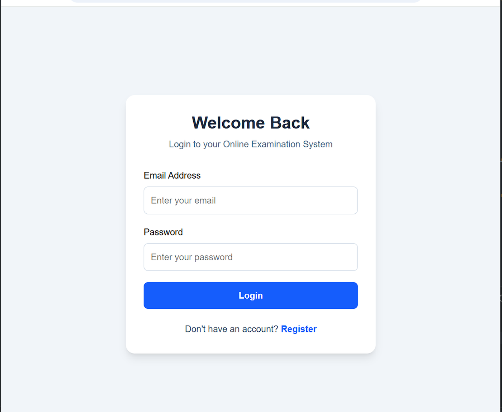
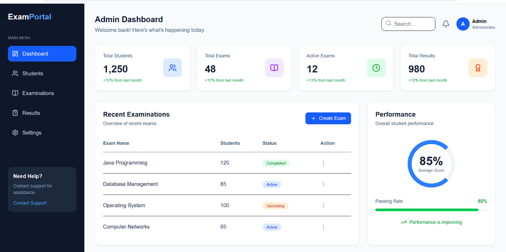
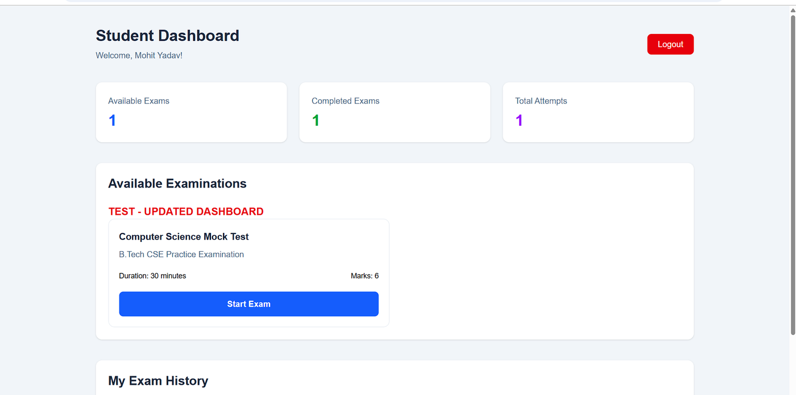

# Online Examination System 🎓

A modern, robust Full-Stack MERN (MongoDB, Express, React, Node.js) based **Online Examination System**. Designed to streamline the examination lifecycle for institutions, schools, and organizations by providing intuitive portals for both administrators and students.

<div align="center">

[](https://github.com/divyanshkashyap129-svg/online-examination-system)
[](#)
[](#)

</div>

---

## 🚀 Key Features

### 👨‍🏫 Administrator Portal
- **Secure Authentication**: Protected admin login with JWT verification and role-based access.
- **Exam Management**: Seamlessly create, edit, update, delete, publish, and unpublish examinations.
- **Question Bank**: Support for multiple choice questions (MCQs), configurable marks, time limits, and negative marking.
- **Real-Time Analytics & Reporting**: Overview of participants, passing ratios, score distributions, and performance graphs.
- **Student Monitoring & Answer Sheets**: Inspect detailed student submissions, automated grade calculation, and student audit history.
- **User Management**: Activate/deactivate student accounts and manage enrollment.

### 👨‍🎓 Student Portal
- **Registration & Profile**: Self-registration and secure login.
- **Exam Hall & Live Test Interface**: Clean, distraction-free environment to attempt available online examinations.
- **Smart Timer & Auto-Save**: Real-time synchronized countdown timer with auto-saving of selected answers.
- **Recovery & Auto-Submission**: Resilient against unexpected page refreshes; automatic paper submission when the timer lapses.
- **Instant Feedback**: View instant scores, detailed performance breakdowns, and correct answers post-submission.

---

## 🛠️ Tech Stack

| Domain | Technologies & Libraries |
| :--- | :--- |
| **Frontend** | React 18, Vite, Tailwind CSS, Lucide Icons, Axios, React Router DOM |
| **Backend** | Node.js, Express.js, RESTful API architecture |
| **Database** | MongoDB & Mongoose ODM |
| **Security & Auth** | JSON Web Tokens (JWT), bcryptjs password hashing, CORS, Helmet |

---

## 📂 Project Architecture

```text
online-examination-system/
│
├── backend/
│   ├── config/          # Database connection & environment configuration
│   ├── controllers/     # API request handlers (Auth, Exam, Question, Result)
│   ├── middleware/      # JWT auth, error handling & role checks
│   ├── models/          # Mongoose database schemas
│   ├── routes/          # Express route definitions
│   ├── server.js        # Server entry point
│   └── package.json
│
├── frontend/
│   ├── public/          # Static assets & favicon
│   ├── src/
│   │   ├── components/  # Reusable UI elements (Navbar, Modals, Cards)
│   │   ├── pages/       # Admin & Student view views
│   │   ├── services/    # Axios API client services
│   │   └── App.jsx      # Root routing & layout
│   └── package.json
│
├── admin-dashboard.png  # Admin view preview
├── student-dashboard.png# Student view preview
├── login-page.png       # Auth preview
└── README.md
```

---

## ⚡ Getting Started

Follow these steps to set up and run the project locally.

### Prerequisites
- [Node.js](https://nodejs.org/) (v16.x or higher)
- [MongoDB](https://www.mongodb.com/) (Local Community Server or MongoDB Atlas cluster)
- [Git](https://git-scm.com/)

### 1. Clone the Repository
```bash
git clone https://github.com/divyanshkashyap129-svg/online-examination-system.git
cd online-examination-system
```

### 2. Configure Backend
Navigate to the `backend` directory and install dependencies:
```bash
cd backend
npm install
```

Create a `.env` file in the `backend/` directory:
```env
PORT=5000
MONGO_URI=your_mongodb_connection_string
JWT_SECRET=your_super_secret_jwt_key
ADMIN_SECRET=your_admin_secret_key
```

Start the backend server:
```bash
npm run dev
# Server will run at http://localhost:5000
```

### 3. Configure Frontend
Open a new terminal tab, navigate to the `frontend` folder and install dependencies:
```bash
cd frontend
npm install
```

Create a `.env` file in the `frontend/` folder (if custom API URL is required):
```env
VITE_API_URL=http://localhost:5000/api
```

Start the Vite development server:
```bash
npm run dev
# Frontend will be live at http://localhost:5173
```

---

## 📸 Screenshots

| Portal | Preview |
| :--- | :--- |
| **Authentication** |  |
| **Admin Dashboard** |  |
| **Student Dashboard** |  |

---

## 👤 Maintainer

**Divyansh Kashyap**  
- GitHub: [@divyanshkashyap129-svg](https://github.com/divyanshkashyap129-svg)

---

## 📄 License
This project is open-source and available under the [MIT License](LICENSE).
